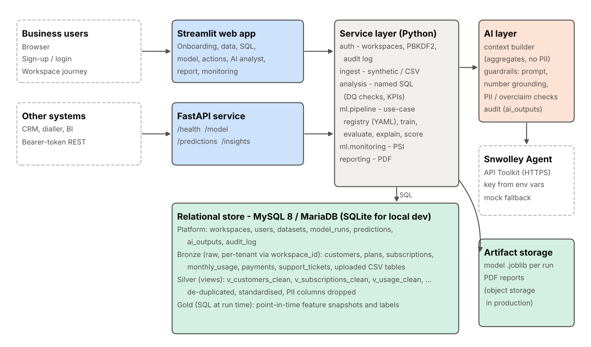

# InsightForge: architecture note

## Components

- **Web app (HTML, CSS, and JavaScript).** The business-facing product: sign-up and login, a workspace with a stated objective, and a guided journey (data, data quality and SQL, model, predictions and actions, AI analyst, report, monitoring). It holds no business logic; pages call the FastAPI service layer.
- **REST API (FastAPI).** Lets other systems pull the latest model summary, scored customers and AI insights (`/v1/workspaces/{id}/model`, `/predictions`, `/insights`). Protected by a service token from the environment; it refuses requests if no token is configured.
- **Service layer (Python package `insightforge`).** `auth` (workspaces, PBKDF2 password hashing, audit log), `ingest` (synthetic generator or CSV upload, size and shape validation), `analysis` (named, parameterised SQL for data-quality checks and business questions), `ml` (use-case registry, training pipeline, monitoring), `agent` (Snwolley integration and guardrails), `reporting` (PDF).
- **Relational store.** MySQL 8 / MariaDB in production, SQLite for zero-setup local runs; the same SQL runs on both. Raw tables (bronze) keep data as received; SQL views (silver) clean, de-duplicate and drop personal data; feature and label queries (gold) build point-in-time snapshots.
- **Use-case registry.** A business problem is a YAML file naming a feature SQL, a label SQL, the horizon and the business assumptions (capacity, costs, save rate). Churn and payment delinquency share one feature query; uploaded CSVs get a generic use case built at run time. Changing the use case does not change code.
- **ML pipeline.** Out-of-time validation (train on earlier snapshots, test on the latest fully observed one), four candidates including a no-skill baseline, selection on PR-AUC for rare outcomes, permutation-importance drivers, per-customer reasons, a campaign simulation, refit and scoring, and a PSI drift baseline. Models are versioned per run (`model_runs` + a joblib artifact).
- **AI layer (Snwolley Agent API Toolkit).** Six tasks are wired into the workflow: data-quality brief, KPI explanation, model explanation, recommended actions, executive summary and grounded Q&A. The live client is configured entirely from environment variables; a deterministic template client with the same contract runs when no key is available and as a labelled fallback.

## How data reaches the AI safely

1. **Minimise.** The context builder sends only aggregates, SQL results and model metrics - never raw rows, names, phone numbers, e-mails or customer IDs. Personal-data columns do not exist in the silver views the builder reads from.
2. **Check before sending.** The pack is scanned for e-mail and phone patterns and size-limited; if anything looks personal, the call is refused (fail closed).
3. **Separate data from instructions.** The context is wrapped in delimiters and declared to be data; strings that came from the data or the user are stripped of markup and truncated.
4. **Constrain the task.** A system prompt requires using only the context, quoting figures exactly, calling drivers associations rather than causes, and saying when the context is insufficient.
5. **Verify the output.** Every number in the answer is matched against the context (allowing rounding and % or k/M scaling). Unmatched figures mark the output "needs review"; personal data blocks it; overclaiming language is flagged. The status is shown beside every AI output in the app and the PDF.
6. **Audit.** Each call stores the prompt hash, the exact context, the output, the validation result, provider and latency in `ai_outputs`.

## Security and configuration

- Secrets (database URL, Snwolley key, API token) come only from environment variables or a git-ignored `.env`; `.env.example` documents them. The settings object hides secrets from logs and reprs, and the database URL is never logged.
- Passwords use PBKDF2-SHA256 with a random salt and constant-time comparison. Every business table carries `workspace_id`, every query filters on it, and dataset and run look-ups check workspace ownership.
- SQL is parameterised; the only dynamic identifiers are upload table names the system generates itself and validates against a strict pattern.
- The HTML frontend displays user-safe error messages; server-side errors go to structured logs. Uploads are limited in size, rows and columns.

## Scaling and operating it

- **Larger data.** Move feature computation into the warehouse as scheduled jobs (Airflow or dbt) that materialise the silver and gold layers incrementally; keep the same SQL. Partition usage and payments by month and index on `(workspace_id, subscription_id, month)`.
- **Streaming.** Usage, payment and ticket events flow through **Kafka** topics; a consumer updates rolling customer aggregates so risk can be re-scored daily or on events such as a sharp usage drop.
- **Serving.** Batch scoring writes to `predictions`; the FastAPI service exposes them to the CRM and dialler and serves the static HTML frontend. Behind a load balancer it scales horizontally.
- **Search and observability.** **Elasticsearch** indexes AI outputs, tickets and audit events for search; **Grafana** dashboards show pipeline health, data-quality trends, PSI drift, model performance once outcomes arrive, and agent latency and review rates.
- **Monitoring and retraining.** At every scoring: PSI per feature and on the score distribution, missing-value rates, and the data-quality checks. When outcomes arrive (90 days later): PR-AUC, reach at capacity and calibration on the new snapshot. Retrain when PR-AUC falls more than 15% below validation, a key feature exceeds PSI 0.25, or the business changes prices or plans.
- **Multi-tenancy at scale.** Per-workspace API tokens and row-level security, or a schema per tenant for large customers; artifacts move to object storage with per-tenant prefixes.
