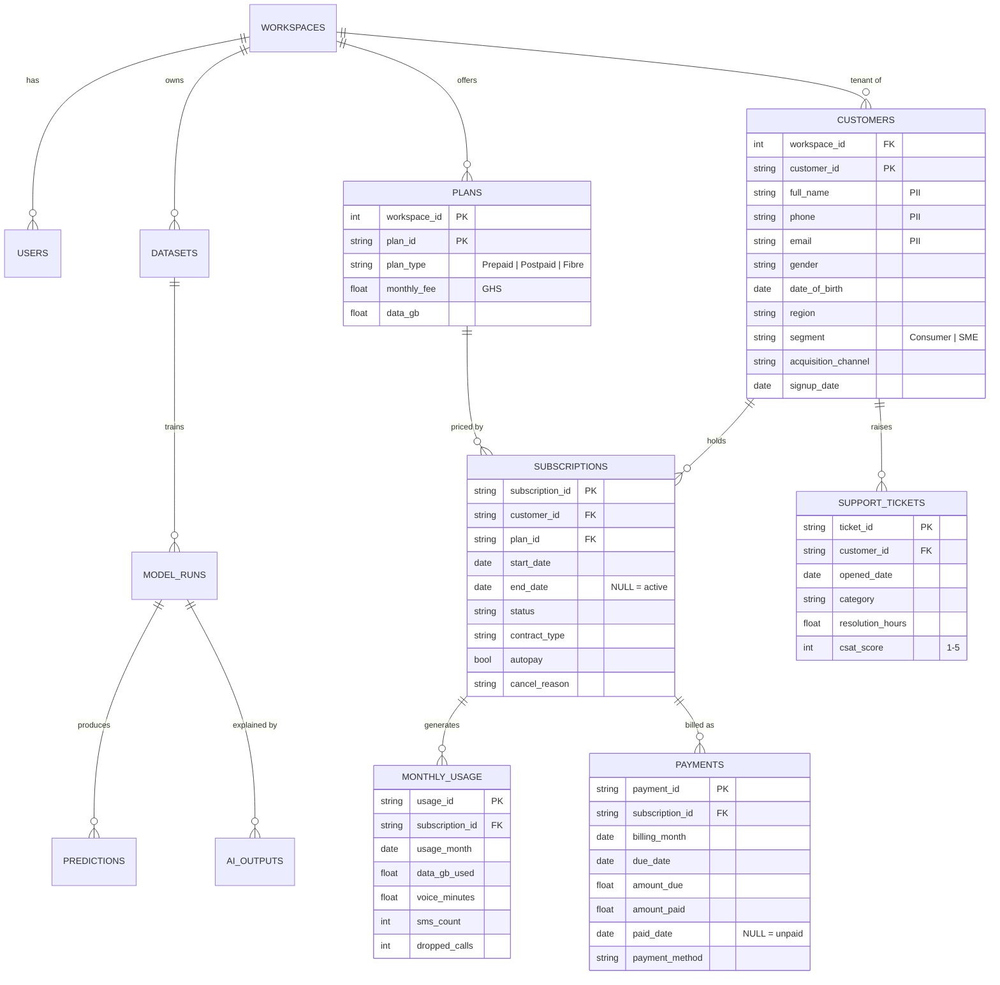

# Data model

## Business scenario

**Kasa Telecom** (fictional) is a Ghanaian mobile and home-fibre operator. It sells monthly prepaid bundles, postpaid plans and fibre broadband, bills monthly (mostly paid through Mobile Money) and runs a support centre. Leadership wants to understand churn and act on it before customers leave.

The generator (`insightforge/datagen/telco.py`) simulates every customer month by month from January 2023 to the as-of date (30 September 2026 by default). Usage, dropped calls, support tickets, CSAT and payments are generated each month; experience problems accumulate into a dissatisfaction score that, with contract type, tenure, autopay, price sensitivity and two market events, drives a monthly churn hazard. Built-in events:

* **October 2025:** prepaid bundle prices rise 15%.
* **April–July 2026:** a competitor promotion in Greater Accra.
* Voluntary leavers usually reduce usage in the 2–3 months before they go; three consecutive missed bills cause involuntary churn.

`python scripts/generate_data.py --seed 42` regenerates byte-identical CSVs (`data/generated/manifest.json` records row counts and SHA-256 checksums).

## Entity-relationship diagram

## Entities and important fields

| Table | Grain | Key fields and meaning |
|---|---|---|
| `workspaces` | one business (tenant) | `objective` (what the business wants), `active_use_case` |
| `users` | one login | `email` (unique), `password_hash` (PBKDF2-SHA256, 240k rounds), `role` |
| `datasets` | one dataset load | `source` (`synthetic_telco` or `csv_upload`), `seed`, `as_of_date`, `row_counts` |
| `customers` | one registration | `customer_id`; `phone`/`email`/`full_name` are personal data and never leave the raw layer |
| `plans` | one product | `monthly_fee` (current GHS price), `data_gb` allowance |
| `subscriptions` | one customer contract | `start_date`, `end_date` (churn = `end_date` set), `contract_type`, `autopay`, `cancel_reason` |
| `monthly_usage` | subscription × month | data, voice, SMS, `dropped_calls` (network quality proxy) |
| `payments` | subscription × billing month | `due_date`, `paid_date`; late = paid after due, unpaid = no payment |
| `support_tickets` | one ticket | `category`, `resolution_hours`, `csat_score` (optional survey) |
| `model_runs` | one training run | use case, selected model, metrics and details (JSON), artifact path |
| `predictions` | entity × run | `score`, `risk_tier`, `value`, `top_reasons` |
| `ai_outputs` | one agent call | task, provider, prompt hash, context sent, output, validation result, status |
| `audit_log` | one event | sign-ups, logins, data loads, training, AI calls, reports |

Every business table carries `workspace_id`; every query filters on it (tenant isolation).

## Layers

| Layer | Where | Purpose |
|---|---|---|
| Bronze (raw) | business tables | Data as received, including errors |
| Silver (clean) | `sql/views.sql` | `v_customers_clean` (de-duplicated by phone with `ROW_NUMBER()`, canonical regions, **no PII columns**), `v_subscriptions_clean` (status re-derived, impossible dates quarantined), `v_usage_clean` (de-duplicated, negative/implausible readings nulled), `v_payments_clean` (double posts removed, `is_late`/`is_unpaid` flags), `v_tickets_clean` (invalid CSAT nulled) |
| Gold (features) | `sql/features/`, `sql/labels/` | Point-in-time customer snapshot and outcome labels, parameterised by snapshot date |

## Injected imperfections (and how they are caught)

| Issue | Approx. rate | Caught by | Handled in |
|---|---|---|---|
| Duplicate customer registrations (same phone) | 1.5% | `customers_duplicate_phone` | `v_customers_clean` |
| Region spelling / case variants, city names | 10% | `customers_nonstandard_region` | `v_customers_clean` |
| Missing region / date of birth / e-mail | 3% / 4% / 12% | `customers_missing_*` | ML imputation + missing flags |
| End date before start date | 0.4% of cancellations | `subscriptions_end_before_start` | quarantined |
| Status not updated on cancellation | 0.6% of cancellations | `subscriptions_status_mismatch` | status re-derived |
| Duplicate usage rows | 0.8% | `usage_duplicate_months` | de-duplicated |
| Negative / missing / 60x usage readings | 0.3% / 0.5% / 0.1% | `usage_negative_or_missing`, `usage_implausible` | nulled, imputed |
| Double-posted bills | 0.5% | `payments_double_posted` | de-duplicated |
| Payment dated before billing month, 10x overpayment | 0.2% / 0.15% | `payments_inconsistent` | flagged, capped |
| CSAT outside 1–5, negative resolution time | 0.6% / 0.3% | `tickets_*` | nulled |
